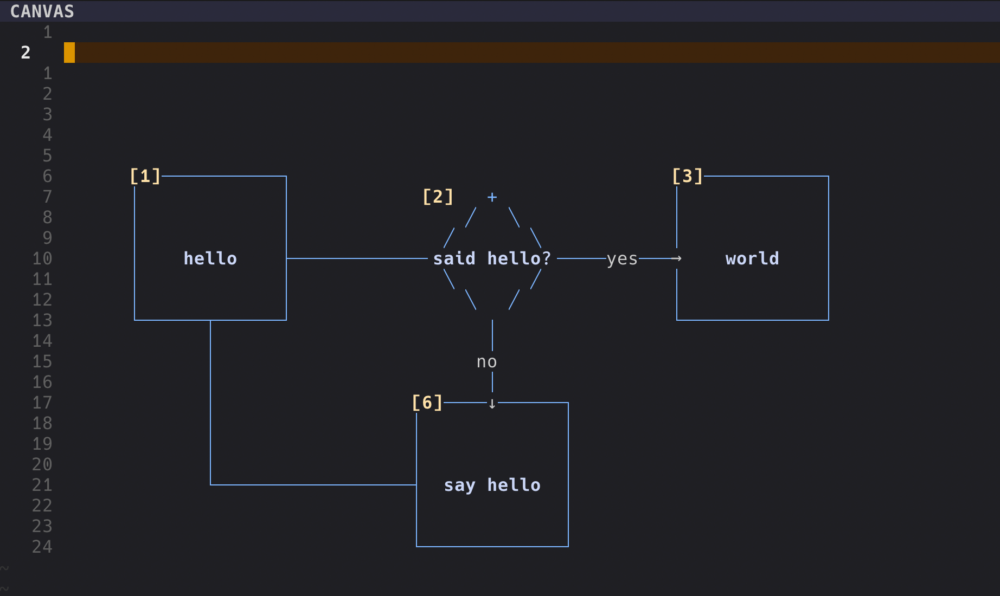
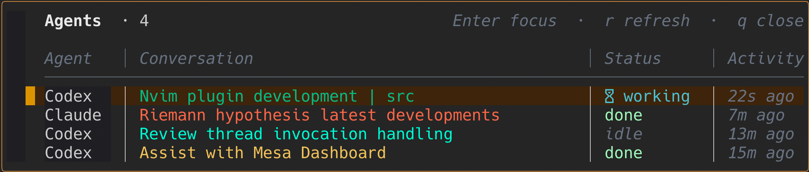

# nvimplugins

Two independent plugins for people who work in Neovim: draw editable diagrams in your documents, and keep track of coding agents across terminal windows.

| Plugin | What it does | Requirements |
| --- | --- | --- |
| [canvas.nvim](plugins/canvas.nvim/) | Draw boxes, diamonds and connectors; save readable text with editable JSON scenes. | Neovim; Python 3 for the optional CLI. |
| [agent-view.nvim](plugins/agent-view.nvim/) | See agent conversations and status, jump to their tmux panes, and receive completion notifications in another editor. | Neovim, Node.js and an installed harness; tmux for navigation. |

Install either plugin or both. They do not depend on one another, a dashboard, or a worktree manager. Tested with Neovim 0.12.1.

## Draw diagrams where you write

Canvas turns text and Markdown buffers into editing surfaces. Create and move shapes, edit labels, and connect objects by ID. The rendered diagram remains in the document when canvas mode ends; JSON preserves its editable scene. The CLI can also move existing Markdown scenes between home storage and colocated sidecars without changing their rendered text.

[Canvas setup, controls and examples →](plugins/canvas.nvim/README.md)

## Find the agent that needs you

Agent view shows an activity-sorted table of native conversation titles, status, starting folders and the most recently edited project. Conversation colors stay consistent across editors and resumed sessions. Select an entry to focus its pane. Completion events reach every running Neovim in the same tmux session, including the editor you switched to while an agent was working.

[Agent setup, hooks and notifications →](plugins/agent-view.nvim/README.md)

## Install with lazy.nvim

This monorepo gives each plugin its own runtime root under `plugins/`. A single checkout can enable either or both. Put this spec in your lazy.nvim plugin list:

~~~lua
{
  'stefankirchfeld/nvimplugins',
  name = 'nvimplugins',
  lazy = false,
  config = function(plugin)
    -- Remove either block if you only want the other plugin.
    local canvas_root = plugin.dir .. '/plugins/canvas.nvim'
    vim.opt.rtp:prepend(canvas_root)
    vim.cmd.source(canvas_root .. '/plugin/canvas.lua')
    require('canvas').setup()

    vim.opt.rtp:prepend(plugin.dir .. '/plugins/agent-view.nvim')
    require('agent_view').setup({ notification_timeout = 5000 })
  end,
}
~~~

Local plugin managers can instead point directly at either plugin directory. Each plugin README includes a single-plugin spec.

**Agent tracking also needs shell/harness setup.** Installing the Neovim UI alone does not register plain `claude`, `codex` or `pi` processes. Follow the [agent quick start](plugins/agent-view.nvim/README.md#quick-start).

## Make the bindings yours

Canvas creates mappings only while canvas mode is active. Agent view exposes a configurable global toggle and buffer-local controls. Both offer setup options to replace or disable their primary controls, plus `on_attach(buf)` for additional local mappings. No particular leader key is required.

Use setup options for plugin-owned controls and `vim.keymap.set()` for your own shortcuts. A startup global mapping cannot reliably replace a buffer-local mapping created later; configure the action or use `on_attach` instead.

## License

[MIT](LICENSE), covering both plugins, helper tools and documentation.
