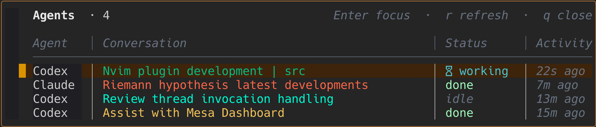
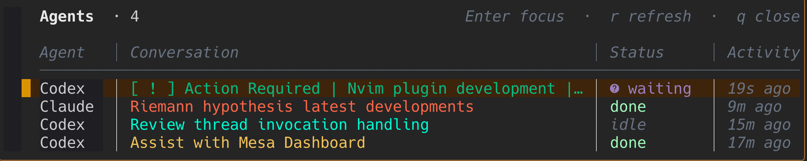

# agent-view.nvim

Find your coding agents from any Neovim instance. See conversation titles, whether an agent is working or waiting for input, and the project it last edited. Select an entry to jump to its tmux pane, or keep editing and receive a completion notification in another editor.

## When an agent needs attention

Permission requests mark the agent as waiting, helping you find the pane that needs your answer:

Starting folder and last edited project are separate: an agent launched from a parent directory can work across repositories without losing that original scope.

## How it works

The launcher registers each agent and loads its harness adapter. Hooks write local JSON; every editor reads the shared directory. No tracking server, networking, worktree manager or transcript parsing is involved. Native terminal titles supply conversation names; recognized edit events supply the last edited project.

| Harness | Adapter | Verification |
| --- | --- | --- |
| Claude Code | Per-launch `--settings` hooks. | Exercised in real sessions. |
| Codex | Guarded command hooks in `CODEX_HOME/hooks.json`. | Exercised in real sessions. |
| Pi | Per-launch session/tool extension. | Adapter provided; a real Pi session is not yet verified. |

Requires Neovim, Node.js and your chosen CLI on PATH. tmux enables pane navigation and session-scoped notifications. Tested with Neovim 0.12.1. Use a Nerd Font for the overview's icons.

## Quick start

### 1. Install the Neovim UI

~~~lua
{
  'stefankirchfeld/nvimplugins',
  name = 'agent-view.nvim',
  lazy = false, -- start background completion monitoring with the editor
  config = function(plugin)
    vim.opt.rtp:prepend(plugin.dir .. '/plugins/agent-view.nvim')
    require('agent_view').setup({ notification_timeout = 5000 })
  end,
}
~~~

Local checkouts can use `plugins/agent-view.nvim` directly. If you used the [landing-page spec](../../README.md#install-with-lazynvim), your lazy.nvim checkout is named `nvimplugins` rather than `agent-view.nvim` in the shell path below.

### 2. Register shell launches and Codex hooks

Set the root to your checkout's plugin directory. With the single-plugin spec above:

~~~sh
AGENT_VIEW_ROOT="$HOME/.local/share/nvim/lazy/agent-view.nvim/plugins/agent-view.nvim"
node "$AGENT_VIEW_ROOT/scripts/install-agent-hooks.cjs"
source "$AGENT_VIEW_ROOT/scripts/agent-shell.zsh"
~~~

Put the root definition and source line in `~/.zshrc` for future interactive shells. `claude`, `codex` and `pi` then register agents, preserve CLI arguments, and use the current folder. Installing the UI alone cannot register a raw CLI process. `command claude` deliberately bypasses tracking.

Codex may ask you to approve newly installed hooks. The installer backs up `hooks.json` and preserves unrelated entries. The launcher enables hooks and uses `--no-daemon` so each agent's environment reaches them. Claude/Pi load their adapters per launch; no global Claude hook installation is needed. Existing processes need a relaunch to receive per-launch adapters.

Other shells can call the launcher directly:

~~~sh
node "$AGENT_VIEW_ROOT/scripts/run-assistant.cjs" codex --cwd "$PWD" -- resume
~~~

Optionally link `bin/nvim-agent` onto PATH, then use `nvim-agent claude --cwd "$PWD" -- --resume`. Everything after `--` goes to the harness.

### 3. Open the overview

Start an agent inside tmux. Run `:Agents` or press `<leader>aa` in Neovim, send the agent a prompt and watch its status. Open another Neovim in the same tmux session to receive its completion notification there.

## Controls and configuration

| Default key | Action |
| --- | --- |
| `<leader>aa` | Toggle the overview. |
| Enter | Focus the selected agent pane. |
| `r` | Refresh. |
| `q` / Escape | Close. |

Each row represents one agent, sorted by latest activity first. Conversation colors are assigned from a pool and stored in the shared state directory, so they remain stable across editors and resumed conversations. The pool reuses colors after it is exhausted. Idle/done use plain status text; working/waiting/error include an attention glyph. Key hints appear as muted virtual text beside the title. Inside its tmux server, focus switches session/window/pane; outside that server, navigation opens a terminal attachment in Neovim.

~~~lua
require('agent_view').setup({
  keymap = '<leader>aa',        -- false disables the global toggle
  notification_timeout = 5000, -- milliseconds
  session_scope = true,        -- false includes other tmux sessions
  width = 120,                -- capped to the available editor width
  max_height = 20,            -- grows with the number of agents
  status_icons = true,        -- false shows plain status text only
  -- colors = { '#7ec8e3', '#f4a261', '#52b788', '#c77dff' },
  -- state_dir = vim.fn.expand('~/.local/state/my-agents'),
  buffer_keymaps = {
    focus = '<CR>',
    refresh = 'r',             -- false disables an action
    close = { 'q', '<Esc>' },  -- strings or lists are accepted
  },
  on_attach = function(buf)
    vim.keymap.set('n', '<leader>x', require('agent_view').close,
      { buffer = buf, desc = 'Close agents' })
  end,
})
~~~

For your own global shortcut, set `keymap = false` and map `require('agent_view').toggle` with `vim.keymap.set()`. Use `buffer_keymaps` for popup controls; `on_attach` runs afterwards and can add or override local keys. Changes apply to the next opened popup.

## Completion notifications

Each running Neovim in the agent's tmux socket/session reads completion events independently. One editor does not consume the event for another. Events survive quick next turns and agent exit; repeated done status does not produce another notification.

The plugin calls `vim.notify()` with a five-second timeout. **Floating timed popups need a notifier that honors that option**, such as [snacks.nvim](https://github.com/folke/snacks.nvim) or [nvim-notify](https://github.com/rcarriga/nvim-notify). Otherwise, Neovim's normal notification display is used.

Events older than the editor's initial plugin setup are ignored. Restarting does not replay old completions; module reload preserves that editor's cursor. Outside tmux, all sessions are included. Neovim must be running to show notifications.

## Optional scratch prompts

Send file context or a visual selection to the neighboring registered agent:

~~~lua
vim.keymap.set('n', '<leader>ai', function()
  require('agent_view.prompt').open()
end, { desc = 'Prompt agent with file context' })
vim.keymap.set('v', '<leader>ai', function()
  require('agent_view.prompt').open_visual()
end, { desc = 'Prompt agent with selection' })
~~~

Write your request in the scratch buffer; `:w` sends it. `open_ref()` sends only a file/line reference. `:Wai WINDOW` selects a window within the current session. Routing uses registered pane IDs in the current window/socket. Missing or ambiguous targets preserve the prompt and report an error rather than guessing another session.

## Status and storage

| Status | Meaning |
| --- | --- |
| idle | Registered, awaiting a prompt. |
| working | Prompt/tool events report activity. |
| waiting | Permission or input is requested. |
| done | Turn finished; it does not guarantee task success. |

Approval resolution has no separate hook here, so waiting can linger until the next tool event. Project tracking recognizes Write/Edit/apply_patch, including creation and patch renames. Arbitrary shell edits are not inferred.

The shared directory also keeps conversation color assignments in `appearance/colors.json`. Use the same color pool across editors for matching colors. On narrow windows the table hides secondary columns to keep conversation/status readable.

The shared directory stores live launcher records, `conversations/` metadata keyed by harness + native conversation ID, and `notifications/` completion events retained for seven days. Resume restores project/file metadata with fresh status and tmux coordinates. Dead launchers are ignored and normal exit removes live records.

If you customize storage, set `NVIM_AGENTS_DIR` for agents and `state_dir` for editors to the **same directory**. The historical compatibility default is `~/.local/state/mesa/agents` or its XDG equivalent; no Mesa code is required. Old environment names remain accepted for migration. Titles and edited file paths are stored locally, but prompts, tokens and transcript bodies are not.

## Troubleshooting and removal

- **No agents listed:** use the shell functions or launcher; UI installation alone is insufficient.
- **No completion popup:** check setup in both editors, matching state paths/tmux scope, and a notifier that supports timed popups.
- **No project label yet:** make a recognized edit; old deleted metadata and shell-only edits cannot be reconstructed.
- **Missing icons:** configure a Nerd Font in the terminal.

Remove only this plugin's Codex hooks:

~~~sh
node "$AGENT_VIEW_ROOT/scripts/install-agent-hooks.cjs" --remove
~~~

Remove the zsh source line and Neovim spec to disable registration/UI. Other hooks are preserved. `--migrate-from /old/scripts` replaces only matching legacy entries.

## Development and license

~~~sh
node --test test/*.test.cjs
~~~

Tests use isolated state and dummy harnesses, including two real headless Neovim processes. [MIT License](../../LICENSE).
