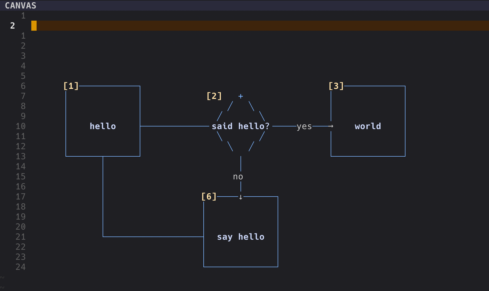
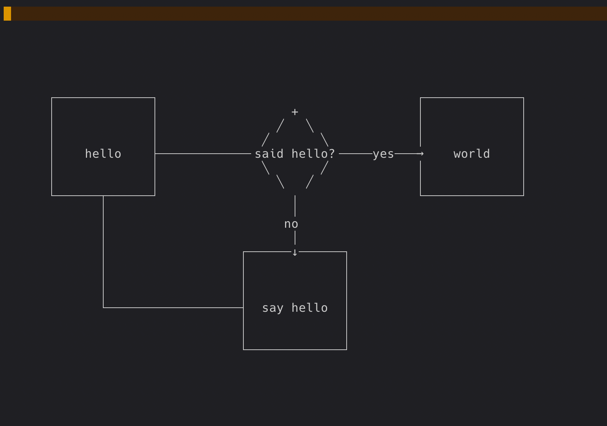

# canvas.nvim

Draw and edit text diagrams without leaving Neovim. Canvas supports rectangles, rounded/double borders, decision diamonds, free text, arrow connectors and multiline labels. Use it for flowcharts, architecture sketches and notes that remain readable in any text editor.



## Editing view → document text

IDs and highlights help you select objects while Canvas is active. Leaving canvas mode removes those overlays and keeps the rendered diagram in your buffer:



Text can be committed and read without the plugin. JSON preserves shapes, positions, labels and connections for future editing.

## Installation

Requires Neovim; tested with 0.12.1. Older versions are not currently verified. No Lua plugin dependencies are required. The optional CLI requires Python 3 and Neovim, without third-party Python packages.

Single-plugin lazy.nvim spec:

~~~lua
{
  'stefankirchfeld/nvimplugins',
  name = 'canvas.nvim',
  config = function(plugin)
    local root = plugin.dir .. '/plugins/canvas.nvim'
    vim.opt.rtp:prepend(root)
    vim.cmd.source(root .. '/plugin/canvas.lua')
    require('canvas').setup()
  end,
}
~~~

For a local checkout, use `plugins/canvas.nvim` as the runtime root. See the [landing page](../../README.md#install-with-lazynvim) to install both plugins from one checkout.

## Your first diagram

1. Open a `.txt`, `.md` or unnamed buffer and run `:Canvas`.
2. Position the cursor, press `<leader>dc`, and enter `br(18, 5, Hello)` to draw a rounded box. Enter applies it.
3. Move elsewhere and draw another box. Their displayed IDs identify them.
4. Open the draw prompt and enter `ca(1, 2)` to connect boxes 1 and 2 with an arrow.
5. Place the cursor on an object and press `e` to edit it, or `m` to move it.
6. Press `q` to leave canvas mode, then `:w` to save the document and scene. Saving the main document also leaves canvas mode.

`<leader>` is your own configured leader. Canvas does not install a global toggle; choose one if you want it:

~~~lua
vim.keymap.set('n', '<leader>cv', '<cmd>Canvas<cr>', { desc = 'Toggle canvas' })
~~~

## Default controls

These are buffer-local and active only in canvas mode.

| Key | Action |
| --- | --- |
| `<leader>dc` | Open a drawing command prompt at the cursor. |
| `e` / `ev` | Edit the selected object in a horizontal/vertical split. |
| `d` | Delete the shape or connector under the cursor. |
| `m` | Enter shape move mode. |
| `<leader>dr` | Re-render the scene. |
| `q` or `:Canvas` | Leave canvas mode and keep the rendered text. |

In move mode, `hjkl` or arrow keys move one cell; uppercase `HJKL` or Shift-arrows move three. Enter/Escape finishes moving. Moving a box carries fully enclosed objects; connectors reroute as needed.

In the drawing prompt, Enter applies a valid command and Escape cancels. A closing `)` also attempts to apply a valid bracket command. In an object editor, `:w` applies, `:wq` applies and closes, and `:q` discards unapplied edits. Clean editors follow the selected object; an unsaved draft stays pinned.

## Drawing commands

| Example | Result |
| --- | --- |
| `b(18, 5, Service)` | Rectangle at the cursor. |
| `br(18, 5, Service)` | Rounded rectangle. |
| `bd(18, 5, Service)` | Double-border rectangle. |
| `bx(2, Approved?)` | Decision diamond at scale 2. |
| `t(Notes)` | Free text. |
| `ca(1, 2)` | Arrow from object 1 to object 2. |
| `cb(1, 2)` | Connector with arrows at both ends. |
| `cad(1, 2)` | Dashed arrow. |

The object editor exposes multiline labels, colors and connector settings. Rectangles grow to fit labels. Diamonds use fixed half-step scales and do not auto-grow for their labels.

## Configure the bindings

Setup is optional. Each primary action can be remapped or disabled:

~~~lua
require('canvas').setup({
  keymaps = {
    draw = '<leader>cd',
    edit = 'e',
    edit_vertical = 'ev',
    delete = false,             -- keep your own d mapping
    move = 'm',
    rerender = '<leader>cr',
    quit = 'q',
  },
  on_attach = function(buf)
    vim.keymap.set('n', '<leader>cp', function()
      require('canvas').rerender(buf)
    end, { buffer = buf, desc = 'Refresh diagram' })
  end,
})
~~~

Set `keymaps = false` to disable all primary canvas mappings. Buffer-local <Plug> actions remain available: `<Plug>(CanvasDraw)`, `CanvasEdit`, `CanvasEditVertical`, `CanvasDelete`, `CanvasMove`, `CanvasRerender` and `CanvasQuit` (all use the same <Plug>(...) form). Map them in `on_attach` with `vim.keymap.set('n', 'X', '<Plug>(CanvasDelete)', { buffer = buf, remap = true })`. `:Canvas` remains available. Configure before opening the canvas; `on_attach` runs after its bindings are created. Existing buffer mappings replaced by Canvas are restored when canvas mode ends. Move mode also restores the active-canvas bindings on exit. Custom keys you add in `on_attach` are yours to manage. Transient move/input controls retain the conventional keys above.

## Markdown and saved scenes

Run `:Canvas` inside a fenced `canvas` block to edit it. If no canvas is selected, the plugin inserts a fence. Explicit sidecars use:

~~~markdown
```canvas file=diagram.canvas.json
…rendered diagram…
```
~~~

Relative `file=` paths resolve alongside the document. Multiple fences can use separate scenes. Saving the document commits all visited scenes; `:edit!` reloads saved document/scenes and discards pending edits.

For rendered-only documents, omit `file=` and keep scene JSON locally under `~/.canvas-nvim/canvases/`. Keep canvas ordering stable because implicit paths include the document path and block order. The [architecture walkthrough](docs/canvas-architecture.md) is an editable example.

## Move existing diagrams between storage modes

The CLI can move every canvas in an existing Markdown document between local home storage and sidecars beside the document:

~~~sh
# Store scenes under ~/.canvas-nvim/canvases/ and remove file= references.
canvas change-persistence notes.md

# Store notes.canvas.json, notes_2.canvas.json, ... beside notes.md.
canvas change-persistence notes.md --mode colocated

# Keep old states if other documents reference the same files.
canvas change-persistence notes.md --keep-source
~~~

The command preserves diagram text, prose, fence styles and line endings. It validates source scenes and checks destination conflicts before writing. Identical destination states are accepted; a different existing state requires `--force` to replace it.

After successfully writing the destination states and updating the document references, it removes old source files unless `--keep-source` is set. Save or discard any active Neovim canvas edits before running the command, then reload the document. See the [CLI reference](tools/canvas-cli/README.md) for details.

## CLI and coding-agent skill

The optional `canvas` CLI uses the same Lua engine. It creates scenes, adds/moves/deletes objects, connects shapes, renders Markdown and validates text crossing box borders. Coding agents can generate an editable scene rather than just an image.

From the plugin directory:

~~~sh
python3 tools/canvas-cli/install.py --dry-run
python3 tools/canvas-cli/install.py
~~~

The installer links `canvas` into `~/.local/bin` and the [canvas-diagrams skill](skills/canvas-diagrams/SKILL.md) into shared Codex/Claude skill locations. It refuses conflicting destinations. Ensure `~/.local/bin` is on PATH.

~~~sh
canvas create diagram.canvas.json
canvas box diagram.canvas.json --id 1 --label Client --row 2 --col 2
canvas box diagram.canvas.json --id 2 --label Server --row 2 --col 30
canvas connect diagram.canvas.json --from 1 --to 2 --shape ca
canvas render diagram.canvas.json
canvas validate diagram.canvas.json
canvas document diagram.canvas.json --output diagram.md --title 'Request flow'
~~~

See the [complete CLI reference](tools/canvas-cli/README.md). CLI writes do not refresh an already-active editor scene; save or discard editor changes before reloading external edits.

## Development and license

~~~sh
python3 -B -m unittest discover -s tools/canvas-cli/tests -v
~~~

[MIT License](../../LICENSE).
